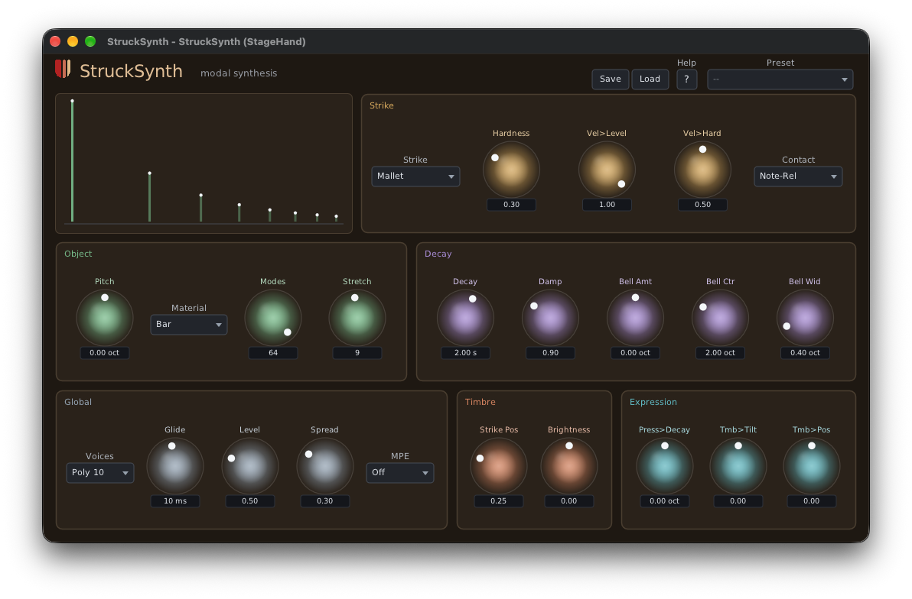

# StruckSynth

A modal-synthesis instrument from Unlikelyware. Each note fires a shaped strike into a bank of up
to 64 tuned resonant modes, so the sound is a struck object (a bell, a bar, a tine, a block) rather
than an oscillator through a filter.



| | |
|---|---|
| Formats | CLAP. VST® 3 and AUv2 (macOS) build from source; ready-built in a later preview |
| Platforms | Linux x86-64, macOS 26 or later on Apple Silicon. No Windows |
| Version | 0.9.0 (preview) |
| License | MIT |

**Downloads:** ready-built plugins will be on itch.io with the 0.9 preview. This repo has the
source only.

## What makes it different

- **A struck object, not an oscillator.** Mallet or noise strikes, material presets, stretch,
  decay, damping, strike position and brightness shape the object. There's no amp envelope: the
  modes' own decay is the envelope, so a note rings on past note-off the way a real one does.
- **MIDI 2.0 first.** The plugin takes MIDI 2.0 notes directly, so a Pitch 7.9 note plays its exact
  microtonal pitch, not the nearest semitone: an EDO keyboard such as
  [KeyboardEDO](https://github.com/erickampman/KeyboardEDO) is heard as played. Per-note pitch bend,
  Pitch 7.25 and per-note controllers reach only the note they name. MIDI 1.0 works too.
- **MPE and CLAP note expressions.** An MPE switch for MPE controllers, and in hosts that send CLAP
  notes (Bitwig) tuning, pressure and brightness arrive per note.

The [help page](Resources/help.md), also behind the editor's Help button, describes every control.
[docs/how-it-works.md](docs/how-it-works.md) has the voice and the MIDI 2.0 details.

StruckSynth has three siblings built on it: [StruckRoom](https://github.com/erickampman/StruckRoom)
(the object inside a room), [StruckGaussian](https://github.com/erickampman/StruckGaussian) (modes as
a random cloud) and [StruckKit](https://github.com/erickampman/StruckKit) (a drum kit).

## Known gaps

- MPE's upper zone isn't supported, and Pitch 7.25 lasts for the sounding note only (no tuning
  table).
- Factory presets are chosen in the editor; CLAP's preset discovery, which lets a host's browser
  list them, isn't implemented.

## Installing

The download holds `StruckSynth.clap`. Put it in your CLAP folder (create the folder if it isn't there),
then rescan plugins in your host:

| | Linux | macOS |
|---|---|---|
| For you | `~/.clap` | `~/Library/Audio/Plug-Ins/CLAP` |
| For every user | `/usr/lib/clap` | `/Library/Audio/Plug-Ins/CLAP` |

On macOS, `~/Library` is hidden in Finder: Go ▸ Go to Folder opens it.

A host that is already running keeps the plugins it loaded: quit and restart it. What each platform
needs, and more on rescanning, is in the downloads repo's [install
notes](https://github.com/erickampman/unlikelyware#installing). To build StruckSynth yourself
instead, see below.

## Building from source

```bash
git clone https://github.com/erickampman/StruckSynth.git
cd StruckSynth
tools/fetch_deps.sh
cmake -B build -G Ninja -DCMAKE_BUILD_TYPE=Release
cmake --build build
```

[BUILDING.md](BUILDING.md) has what to install first on Linux and macOS, the tests, installing
the plugin for hosts, and the build options.

## Help and bugs

Questions and bug reports go to [GitHub Issues](https://github.com/erickampman/StruckSynth/issues).

## License

MIT. See [LICENSE](LICENSE) and [THIRD_PARTY_NOTICES.md](THIRD_PARTY_NOTICES.md).

## Trademarks

VST is a registered trademark of Steinberg Media Technologies GmbH. Audio Units, Logic, Mac and
macOS are trademarks of Apple Inc., registered in the U.S. and other countries. Linux is the
registered trademark of Linus Torvalds in the U.S. and other countries. Other product names are
trademarks of their owners, named here only to say what works with what.
